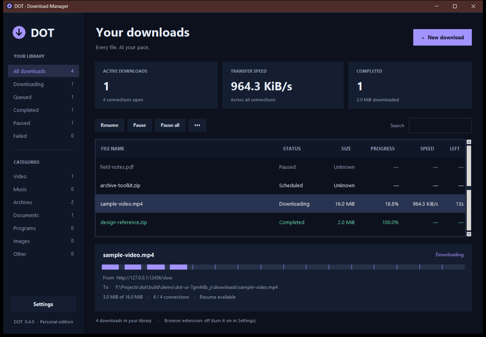
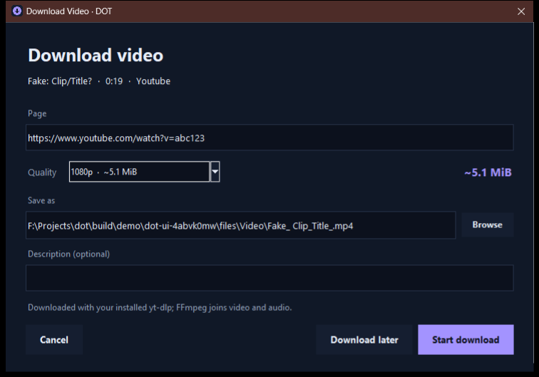
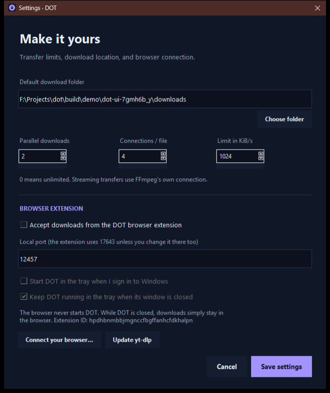

# DOT Download Manager

A download manager for Windows in the spirit of IDM: fast parallel downloads, a browser
extension that hands your downloads to DOT, a **Download with DOT** button on videos, and
video downloads from YouTube and many other sites.



## Download

Get **DOT-Setup-0.4.7.exe** from the [latest release](https://github.com/GitGuardianX/dot-download-manager/releases/latest)
(Windows 10/11, 64-bit).

- It installs for your Windows account only, with no admin prompt, into `%LOCALAPPDATA%\Programs\DOT`.
  The wizard also offers an all-users install.
- The installer isn't code-signed yet, so SmartScreen may say "Windows protected your PC":
  choose **More info → Run anyway**.
- yt-dlp, Deno and FFmpeg are included; there's nothing else to install.
- Uninstall from Settings → Apps → Installed apps. It asks before deleting your download list and
  settings, and never deletes downloaded files.
- Portable use: copy the installed folder anywhere and put an empty `portable.txt` beside `DOT.exe`.

## Features

- **Fast, resumable downloads:** up to 16 connections per file, 1–6 downloads at once, pause/resume,
  queues, scheduling, a speed limit and SHA-256 checks.
- **Browser integration (Brave, Chrome, Edge):** downloads you start in the browser open DOT's
  Download File Info window with the size already checked; the browser's copy is cancelled.
- **Video button:** **Download with DOT** appears over playing videos. Direct files are sent as-is.
  For HLS/DASH streams DOT lists every quality with its bitrate, length and size (like IDM), then
  downloads the pieces with the browser's referrer and user agent and saves one MP4.
- **Video sites:** YouTube and the many other sites yt-dlp supports, with a choice of quality
  (1080p, 720p, … or audio only).
- **Right-click** any link or video: **Download with DOT**.
- **Lives in the tray** like IDM: closing the window keeps DOT running, and it can start with Windows.
- **Organized:** downloads are sorted into Video, Music, Archives, Documents, Programs and Images folders.
- **Easy to clear:** remove the selected, completed, failed or all downloads in one step, even thousands;
  downloaded files stay on disk unless you choose to delete them too.

| Choosing a video quality | Settings |
|---|---|
|  |  |

## Connect your browser

The extension is loaded in Developer mode for now (a Chrome Web Store listing is planned).
On first start DOT opens **Connect your browser**, which walks you through it:

1. Open your browser's extensions page (`brave://extensions`, `chrome://extensions` or
   `edge://extensions`); DOT has a button for it.
2. Turn on **Developer mode**.
3. Click **Load unpacked** and choose `%LOCALAPPDATA%\Programs\DOT\browser-extension`.
4. Click the DOT icon in the toolbar once; the guide turns green.

If IDM is installed, turn off its integration for that browser: IDM takes matching downloads
before the browser, or DOT, sees them.

## Safety design

An early prototype's browser integration (0.2) coincided with a full-system freeze, so the
integration was rebuilt around strict rules (see the [incident report](analysis/INCIDENT-20261126.txt)):

- The browser never starts a program: there is no native messaging, and DOT's local bridge only
  accepts requests from its own extension.
- Nothing runs at browser start-up, and the video button is event-driven (no page scanning or timers).
- Hand-offs are bounded: one at a time, at most 8 automatic ones per minute and 3 open windows.
  When DOT is closed or busy, the browser simply keeps the download.
- yt-dlp and FFmpeg run only inside DOT, after you confirm a download.

Real-browser checks run in a headless Brave inside a Windows job with hard CPU, memory and process
limits (`tools/validate_extension_brave.py`).

## Build from source

Requirements: Windows 10/11, Python 3.11+ with Tk (releases use 3.14), Node.js for the extension
tests, and [Inno Setup 6](https://jrsoftware.org/isinfo.php) for the installer
(`winget install JRSoftware.InnoSetup`).

```powershell
python -m dotdm                                      # run from source; data stays in .local
python -m unittest discover -s tests -v              # unit tests (+ extension tests when Node is installed)
powershell -ExecutionPolicy Bypass -File build.ps1   # tests, DOT.exe, tools, installer -> dist\DOT-Setup-<version>.exe
```

DOT itself uses only the Python standard library; `requirements-dev.txt` (PyInstaller, Pillow) is
for building. `python tools/fetch_tools.py` downloads the pinned yt-dlp, Deno and FFmpeg into
`build\tools\bin`, which source mode uses too.

More checks:

- `python tools/validate_extension_brave.py` tests the extension in a resource-capped headless Brave
  (needs Brave installed).
- `python tools/smoke_installer.py dist\DOT-Setup-<version>.exe` does a silent trial install, checks
  it, then uninstalls (it refuses to run while DOT is installed).

## Project layout

| Path | What it is |
|---|---|
| `dotdm/engine.py` | Download engine: parallel byte ranges, resume, queue, scheduling |
| `dotdm/bridge.py` | Local bridge the browser extension talks to |
| `dotdm/ui.py`, `dotdm/tray.py` | Tk window and dialogs; tray icon |
| `dotdm/sites.py`, `dotdm/streams.py` | yt-dlp (video sites) and FFmpeg (HLS/DASH streams) |
| `dotdm/paths.py`, `dotdm/integration.py` | Install modes, folders and tool lookup; start with Windows |
| `browser-extension/` | Manifest V3 extension |
| `installer/` | Inno Setup script; pinned tool versions and hashes |
| `tests/`, `tools/` | Unit tests; build, validation and smoke-test scripts |
| `analysis/` | Changelogs and the 0.2 incident report |

## Third-party software

The installer bundles these programs, unmodified. They're downloaded at build time by
`tools/fetch_tools.py`, pinned in `installer/tools.json` and checked against the publishers'
SHA-256 (`installer/tools.lock.json`); they aren't stored in this repository.

- [yt-dlp](https://github.com/yt-dlp/yt-dlp) 2026.11.23: Unlicense
- [Deno](https://github.com/denoland/deno) 2.9.8: MIT
- [FFmpeg](https://ffmpeg.org) n8.1.3, LGPL shared build from
  [FFmpeg-Builds](https://github.com/FFmpeg-Builds/FFmpeg-Builds): LGPL 2.1 or later; source at
  [ffmpeg.org](https://ffmpeg.org/download.html)
- Python (PSF License) and Tcl/Tk (BSD-style license), packaged with `DOT.exe`

## Limits and responsible use

DRM-protected video (Netflix, Prime Video, Disney+, Spotify) can't be downloaded by DOT or any
legitimate tool. Private, members-only and age-restricted videos fail with yt-dlp's reason; DOT
doesn't pass your account logins to yt-dlp. Only download content you have the right to download,
and respect each site's terms.

DOT is an independent project and is not affiliated with Internet Download Manager or Tonec Inc.

## License

[MIT](LICENSE). The bundled third-party programs keep their own licenses (see above).
